# ThreadFlow — Knitwear Production Intelligence & Critical Path OS

> **Know the delay before it happens.**  
> Real-time shop floor telemetry, deterministic "Show-Your-Math" run-rate risk engine, bilingual Tamil/Hindi voice AI, and multi-tenant buyer visibility engineered for export garment manufacturers.

<p align="center">
  <a href="https://www.typescriptlang.org/"></a>
  <a href="https://react.dev/"></a>
  <a href="https://nodejs.org/"></a>
  <a href="https://www.postgresql.org/"></a>
  <a href="https://www.prisma.io/"></a>
  <a href="https://tailwindcss.com/"></a>
  <a href="#"></a>
</p>

---

## Executive Overview & Business Value

Built for knitwear export clusters (such as Tiruppur, Tamil Nadu) manufacturing 500+ export purchase orders annually (₹95–110 Crore turnover) for UK and European retail brands.

ThreadFlow replaces fragmented WhatsApp chats, manual phone calls, and static spreadsheets with an automated, explainable operational command center that halts a **₹1.08 Crore annual financial bleed**:

| Source of Loss | Pre-ThreadFlow Reality | With ThreadFlow | Annual Financial Recovery |
| :--- | :--- | :--- | :---: |
| **Emergency Air Freight** | 15 orders/yr forced to air cargo @ ₹3.5L extra | 10-day advance bottleneck warning & buffer mitigation | **₹52.5 Lakh** |
| **Late Delivery Deductions** | 25 orders hit with 5% invoice contract penalties | Proactive schedule recovery & buyer sign-off alignment | **₹26.25 Lakh** |
| **Merchandiser Chasing Overhead** | 12 merchandisers spending 2 hrs/day calling units | Automated real-time floor telemetry & voice updates | **₹28.8 Lakh** |
| **Total Annual Recovery** | | | **₹1.08 Crore / yr** |

---

## Interactive Platform Walkthrough & Feature Guide

Explore each area of ThreadFlow, how to navigate to that screen, and the engineering that powers it.

---

### 1. Unified Navigation Sidebar & Factory Horizon Calendar

The persistent operational command backbone accessible across the platform, providing instantaneous workspace switching, role-scoped links, and an interactive production horizon calendar.

<p align="center">
  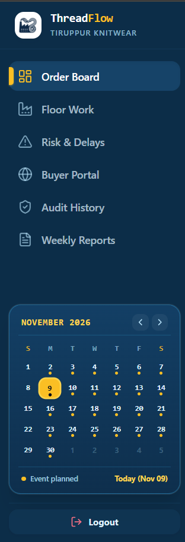
</p>

* **How to Navigate There:**
  * **Role:** Persistent for all authenticated roles (`ADMIN`, `MERCHANDISER`, `SUPERVISOR`, `BUYER`).
  * **Path:** Located on the left-hand rail of every desktop viewport across all routes.
* **Key Functionality:**
  * **Cluster Identity & Branding:** Features the official ThreadFlow Tiruppur Knitwear seal with real-time connectivity status.
  * **Role-Aware Primary Navigation:** Instant switching between **Order Board** (`/orders`), **Floor Work** (`/floor`), **Risk & Delays** (`/risks`), **Buyer Portal** (`/buyer`), **Audit History** (`/audit`), and **Weekly Reports** (`/reports`). Unpermitted modules are automatically hidden for restricted roles (e.g., buyer isolation).
  * **Interactive Horizon Calendar:** Live month-at-a-glance planner calibrated to the operational horizon (`NOVEMBER 2026`). Highlights current day (`Today (Nov 09)`), displays gold indicators on dates with planned ex-factory handoffs or milestone completion targets, and allows month navigation (`<` / `>`) to inspect upcoming critical shipping weeks.
  * **Secure Session Logout:** One-tap authenticated JWT session destruction and local queue cache flush.

---

### 2. Export Orders Board & Critical Path Overview

The primary mission control dashboard for merchandisers and factory leadership, providing cross-factory visibility across all active purchase orders, assigned production units, shipping calendar weeks (CW), and real-time status.

<p align="center">
  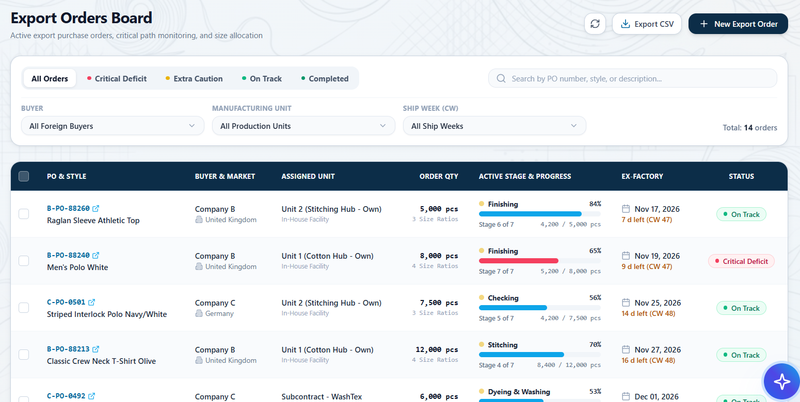
</p>

* **How to Navigate There:**
  * **Role:** `ADMIN`, `MERCHANDISER`, or `SUPERVISOR`
  * **Path:** Click **Order Board** in the left sidebar menu (or navigate to `/orders`).
* **Key Functionality:**
  * **Live Status Filter Chips:** Instantly filter orders by `All Orders`, `Critical Deficit`, `Extra Caution`, `On Track`, and `Completed`.
  * **Multi-Parameter Filtering:** Sift orders by Foreign Buyer (`Company B (UK)`, `Company C (Germany)`, etc.), Manufacturing Hub (Own Units vs Subcontractors), or Shipping Calendar Week (`CW 47`, `CW 48`, etc.).
  * **Real-Time Progress Indicators:** Displays active TNA stage (e.g., `Finishing`, `Checking`, `Stitching`), completed vs target piece counts, and exact ex-factory dates with countdown days remaining.
  * **One-Click Actions:** Direct access to `Export CSV` and `+ New Export Order` creation wizard with automatic 7-stage TNA schedule generation.

---

### 3. Purchase Order Deep Dive, Financials & Size Allocation

Detailed commercial and physical breakdown of individual purchase orders, linking commercial FOB value directly to size ratios and verified garment counts.

<p align="center">
  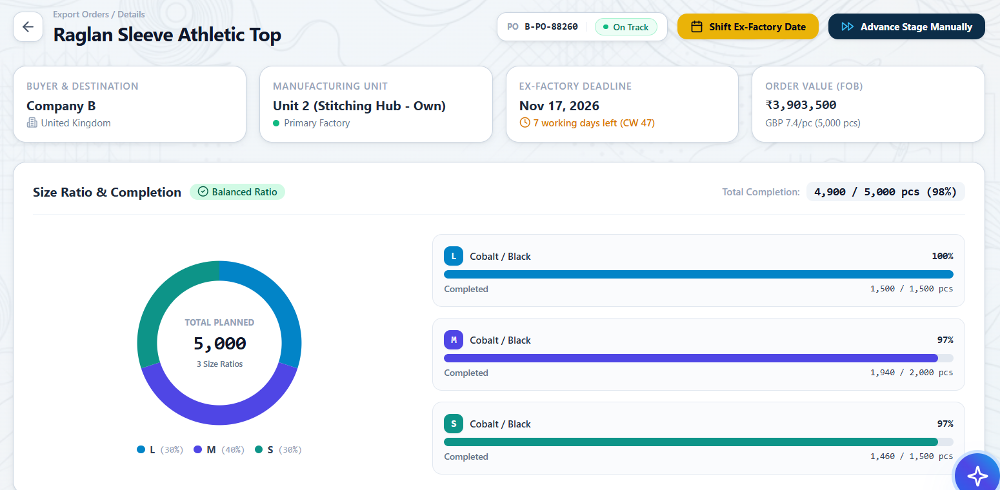
</p>

* **How to Navigate There:**
  * **Role:** `ADMIN`, `MERCHANDISER`
  * **Path:** From the **Order Board**, click any PO number link (e.g., `B-PO-88260`) to open `/orders/:id`.
* **Key Functionality:**
  * **Commercial Summary Header:** Real-time display of destination market, assigned manufacturing unit, ex-factory deadline (with non-Sunday working days remaining), and total FOB order value in INR and foreign currency (e.g., `₹3,903,500` / `GBP 7.4/pc`).
  * **Visual Size Breakdown Donut & Progress:** Compares planned order ratios against completed physical garments across all sizes (`S`, `M`, `L`, `XL`).
  * **Strict Cap Verification:** Enforces that completed pieces strictly respect planned order lines (e.g., Size L: 1,500/1,500 pcs @ 100%, Size M: 1,940/2,000 pcs @ 97%), preventing accidental over-allocation or phantom production.
  * **Rescheduling Actions:** Features the `Shift Ex-Factory Date` button (which triggers mandatory cryptographic audit logging) and `Advance Stage Manually`.

---

### 4. 6/7-Stage Time & Action (TNA) Milestone Pipeline

Interactive visual pipeline detailing each critical manufacturing stage from knitting to final packing, complete with buffer margins and upstream lead time dependencies.

<p align="center">
  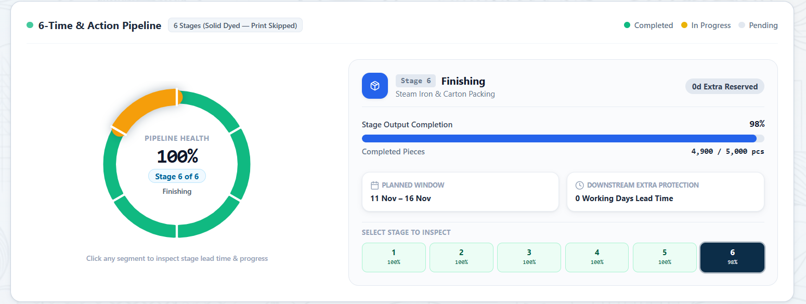
</p>

* **How to Navigate There:**
  * **Role:** `ADMIN`, `MERCHANDISER`
  * **Path:** Inside `/orders/:id`, scroll down to the **Time & Action Pipeline** card.
* **Key Functionality:**
  * **Circular Pipeline Health Gauge:** Dynamic health percentage showing overall milestone completion (e.g., `Stage 6 of 6 — Finishing @ 100% Health`).
  * **Dynamic Stage Adaptation:** Automatically detects product specifications (e.g., solid-dyed garments skip the printing stage to form a streamlined 6-stage pipeline, while printed items run a full 7-stage pipeline).
  * **Stage Inspection Navigator:** Click any interactive stage badge (`1 Knitting`, `2 Dyeing/Washing`, `3 Cutting`, `4 Stitching`, `5 Checking`, `6 Finishing`) to inspect planned date windows, completed piece counts, and downstream extra protection buffers.
  * **Predecessor Invariant Enforcement:** Physically prevents downstream stages from recording more output than has been cleared by preceding upstream stages.

---

### 5. Shop Floor Production Hub & Active Work Orders

High-contrast, touch-optimized shop floor view designed for factory supervisors and unit heads to view operational queues and log daily shifts.

<p align="center">
  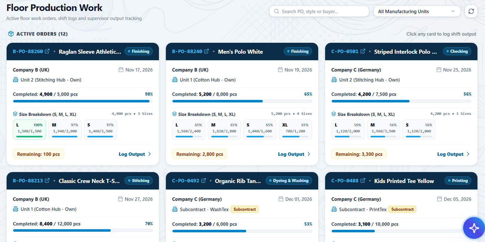
</p>

* **How to Navigate There:**
  * **Role:** `SUPERVISOR`, `MERCHANDISER`, `ADMIN`
  * **Path:** Click **Floor Work** in the left sidebar menu (or navigate to `/floor`).
* **Key Functionality:**
  * **Live Order Cards:** Displays active shop floor purchase orders with per-size fulfillment meters, remaining piece count badges, and current milestone badges.
  * **Unit Scoping:** Factory supervisors (e.g., Muthu in Unit 1, Selvam in Unit 2) automatically see their designated factory unit's work orders by default.
  * **One-Tap Output Entry:** Clicking **Log Output** on any card instantly launches the bilingual shift entry modal for that specific order.

---

### 6. Shift Output Logging & Strict Cap Enforcement

A resilient shift entry form enabling supervisors to log day or night production outputs with per-size precision and zero overrun tolerance.

<p align="center">
  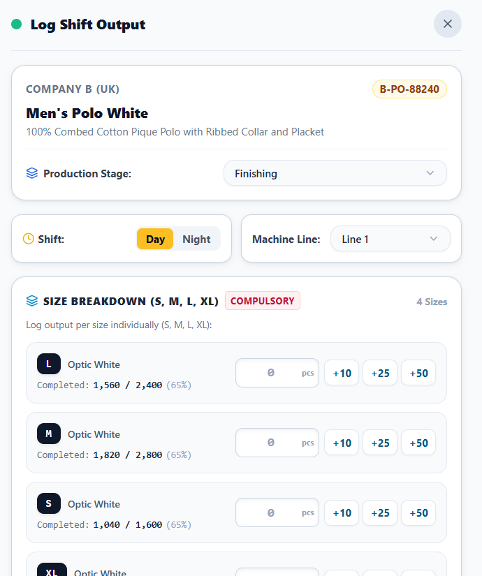
</p>

* **How to Navigate There:**
  * **Role:** `SUPERVISOR`, `ADMIN`
  * **Path:** Inside **Floor Work** (`/floor`), tap the **Log Output** button on any order card.
* **Key Functionality:**
  * **Shift & Line Routing:** Toggle between `Day` and `Night` shifts and select the designated machine line (`Line 1`, `Line 2`, `Packing Line`).
  * **Compulsory Size Breakdown Matrix:** Output must be logged per size (`S`, `M`, `L`, `XL`) with quick-add helper buttons (`+10`, `+25`, `+50`) for rapid floor data entry on mobile devices.
  * **Strict Cap Amount Validation:** Rejects any input that causes a size line or the stage total to exceed the planned cap. An instant warning alerts the supervisor:
    > *"Size L output exceeds required cap of 1,500 pcs! Maximum remaining allowed: 0 pcs. Please recheck your entry."*
  * **Automatic Summation:** Automatically sums individual size counts to ensure aggregate good output matches the total stage delivery.

---

### 7. Multi-Select Floor Issue Chips & Bilingual Voice Telemetry

Empowers floor supervisors to capture mechanical disruptions and voice notes in native languages (`தமிழ்`, `English`, `हिंदी`) with zero keyboard dependency.

<p align="center">
  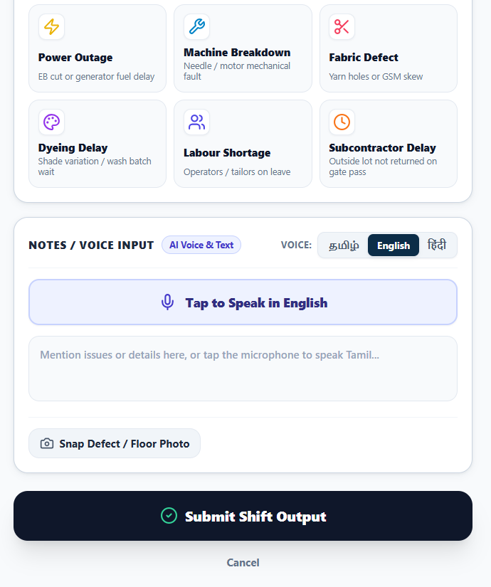
</p>

* **How to Navigate There:**
  * **Role:** `SUPERVISOR`, `ADMIN`
  * **Path:** Inside the **Log Shift Output** modal, scroll to the bottom section.
* **Key Functionality:**
  * **Multi-Select Operational Issue Chips:** Tap one or multiple visual chips to classify disruptions:
    * ⚡ **Power Outage** (EB cut / generator fuel delay)
    * 🔧 **Machine Breakdown** (Needle / motor mechanical fault)
    * ✂️ **Fabric Defect** (Yarn holes / GSM skew)
    * 🎨 **Dyeing Delay** (Shade variation / wash batch wait)
    * 👥 **Labour Shortage** (Operator / tailor absenteeism)
    * ⏱️ **Subcontractor Delay** (Outside lot not returned on gate pass)
  * **Bilingual Voice Recognition:** Powered by the browser's native **Web Speech API** (`ta-IN`, `hi-IN`, `en-IN`). Supervisors tap the microphone and speak colloquially in Tamil or Hindi.
  * **Gemini AI Root-Cause Classifier:** Analyzes spoken transcripts using Google Gemini API to extract root causes, falling back to a deterministic dual-script regex dictionary (`TAMIL_FALLBACK_DICTIONARY`) if network latency exceeds 3 seconds.
  * **Photo Defect Capture:** Built-in camera integration with automatic client-side canvas compression (< 800 KB) and offline IndexedDB queueing.

---

### 8. Human-in-the-Loop Risk Review Gate

Protects commercial buyer relationships by routing shop floor operational disruptions to senior merchandisers for triage before international buyers are notified.

<p align="center">
  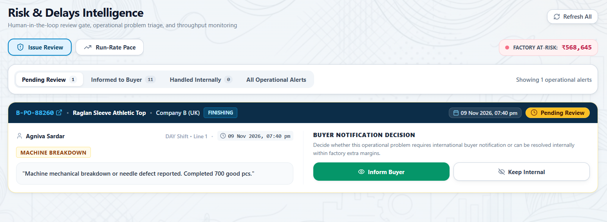
</p>

* **How to Navigate There:**
  * **Role:** `MERCHANDISER`, `ADMIN`
  * **Path:** Click **Risk & Delays** in the left sidebar menu $\to$ select the **Issue Review** tab (or navigate to `/risks`).
* **Key Functionality:**
  * **Factory At-Risk Counter:** Real-time badge computing total financial exposure across all open operational bottlenecks (e.g., `FACTORY AT-RISK: ₹568,645`).
  * **Automated Risk Escalation:** Any floor log with an operational disruption (e.g. *Machine Breakdown*) automatically elevates the milestone to `AMBER` / `PENDING_REVIEW` status so it immediately surfaces here.
  * **Buyer Notification Decision Gate:**
    * 🟢 **Inform Buyer:** Approves the risk alert and dispatches an official schedule notification to the foreign buyer portal with transparent recovery dates.
    * ⚪ **Keep Internal:** Resolves the issue using in-house buffers (overtime, extra line allocation) without causing buyer panic or commercial penalties.

---

### 9. Deterministic "Show-Your-Math" Run-Rate Engine

Eliminates speculative guesswork with mathematical proof of delivery pacing, comparing required run-rate against real floor velocity.

<p align="center">
  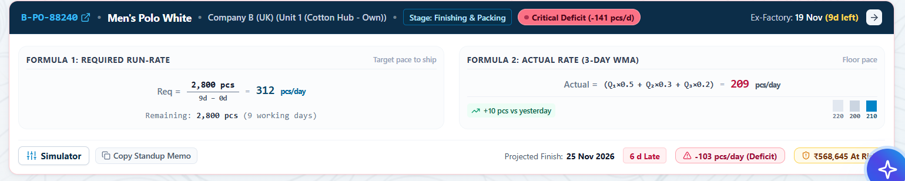
</p>

* **How to Navigate There:**
  * **Role:** `MERCHANDISER`, `ADMIN`
  * **Path:** Inside **Risk & Delays** (`/risks`), select the **Run-Rate Pace** tab.
* **Key Functionality:**
  * **Formula 1 (Required Run-Rate):**
    $$\text{Req} = \frac{\text{Remaining Pieces}}{\text{Working Days} - \text{Downstream Buffer}}$$
    *Calculates exact pieces per day required to hit ex-factory deadlines, strictly excluding non-working Sundays and reserving downstream quality buffers.*
  * **Formula 2 (Actual Rate via 3-Day Weighted Moving Average):**
    $$\text{Actual WMA} = (Q_{\text{today}} \cdot 0.50) + (Q_{\text{yesterday}} \cdot 0.30) + (Q_{\text{day-2}} \cdot 0.20)$$
    *Prioritizes recent floor velocity over distant averages.*
  * **Projected Finish Date & Financial Exposure:** Displays the exact forecasted completion date, deficit or surplus in pcs/day, days late, and rupee value at risk.
  * **Standup Memo Generator:** One-click `Copy Standup Memo` formats an executive briefing ready for daily production meetings.

---

### 10. Multi-Tenant Scoped Buyer Portal & Collaborative Sign-Off

Secure, tenant-isolated transparency portal for international buyers (UK, Germany, EU) to track orders and sign off on milestone quality.

<p align="center">
  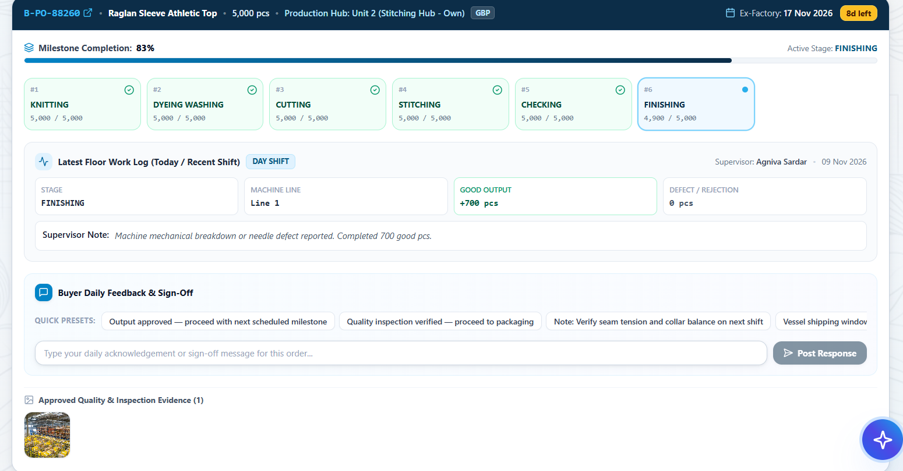
</p>

* **How to Navigate There:**
  * **Role:** `BUYER` (e.g. Sarah Jenkins for UK, Klaus Mueller for Germany) or `ADMIN`
  * **Path:** Click **Buyer Portal** in the sidebar menu (or navigate to `/buyer`).
* **Key Functionality:**
  * **Strict Data Isolation:** Foreign buyers can only see purchase orders belonging to their buyer ID or buyer code. European buyers cannot view UK orders, and vice versa.
  * **Milestone Progress & Verified Evidence:** Displays verified completion percentages and approved quality inspection photos only after merchandiser confirmation.
  * **Buyer Daily Feedback & Sign-Off:** Provides quick presets (`Output approved — proceed with next scheduled milestone`, `Quality inspection verified`, `Vessel shipping window confirmed`) and a response channel for contractual sign-offs.

---

### 11. Tamper-Evident Cryptographic Audit History

An immutable, append-only compliance ledger recording every schedule shift, milestone override, and buyer response.

<p align="center">
  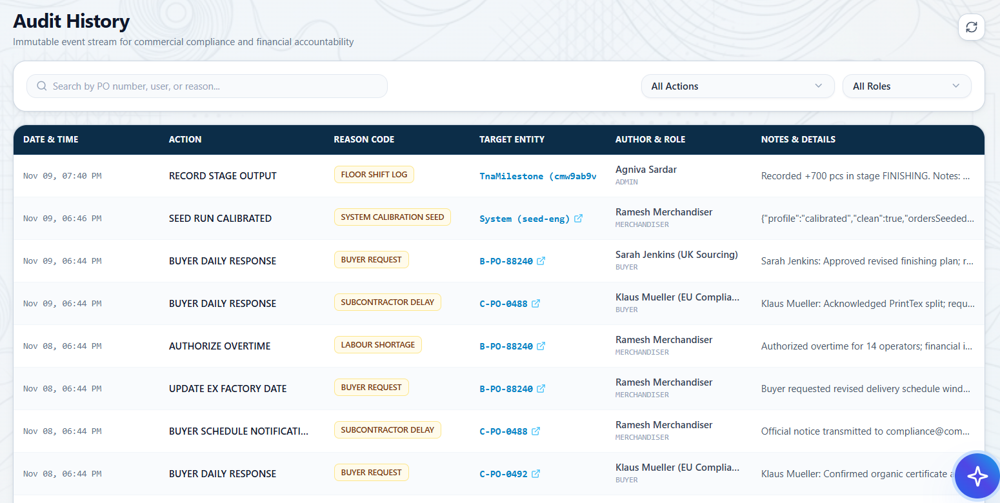
</p>

* **How to Navigate There:**
  * **Role:** `ADMIN`, `MERCHANDISER`
  * **Path:** Click **Audit History** in the left sidebar menu (or navigate to `/audit`).
* **Key Functionality:**
  * **SHA-256 Merkle Hash Chaining:** Every event calculates an HMAC/SHA-256 hash linking `previousHash`, `timestamp`, `action`, `reasonCode`, `targetEntityId`, and acting `userId`. Any unauthorized database mutation breaks the cryptographic chain.
  * **Mandatory Commercial Reason Codes:** Rescheduling an ex-factory date or overriding a milestone requires selecting verified reasons (`BUYER_REQUEST`, `FABRIC_DELAY`, `LABOUR_SHORTAGE`, `SUBCONTRACTOR_DELAY`, etc.).
  * **Complete Audit Trail Filter:** Search and filter event streams by PO number, action category, author, or role.

---

### 12. 5-Week TNA Pipeline Velocity & Executive Reporting

Strategic analytics for factory leadership and brand sourcing directors comparing weekly garment throughput and stage velocity.

<p align="center">
  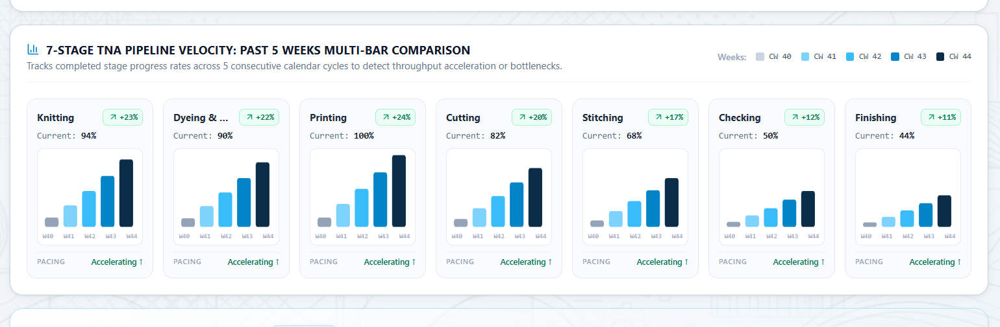
</p>
<p align="center">
  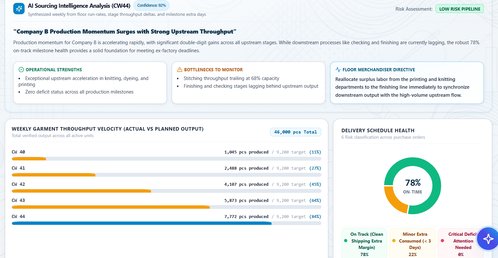
</p>

* **How to Navigate There:**
  * **Role:** `ADMIN`, `MERCHANDISER`
  * **Path:** Click **Weekly Reports** in the left sidebar menu (or navigate to `/reports`).
* **Key Functionality:**
  * **5-Week Multi-Bar Comparison:** Visualizes throughput trends across all 7 TNA stages over five consecutive calendar weeks (`CW 40` to `CW 44`) with velocity growth badges (e.g., `Knitting: 94% [↗ +23%]`).
  * **AI Sourcing Intelligence Analysis:** Synthesizes weekly production logs into executive insights with quantified confidence scores:
    * 🟢 **Operational Strengths** (e.g., *Exceptional upstream acceleration in knitting and dyeing*)
    * ⚠️ **Bottlenecks to Monitor** (e.g., *Stitching trailing behind upstream volume*)
    * 🧭 **Floor Merchandiser Directive** (actionable labor re-allocation instructions)
  * **Delivery Schedule Health Donut:** Clear percentage of on-time POs vs minor buffer consumed vs critical deficits.
  * **Executive PDF Generation:** One-click **Print Full Page PDF** compiles a formatted commercial pack for brand sourcing meetings.

---

### 13. ThreadFlow AI Copilot: Natural Language Orders & Risk Assistant

An intelligent, context-aware conversational copilot available anywhere in the workspace for querying active production orders, milestone statuses, and critical risks.

<p align="center">
  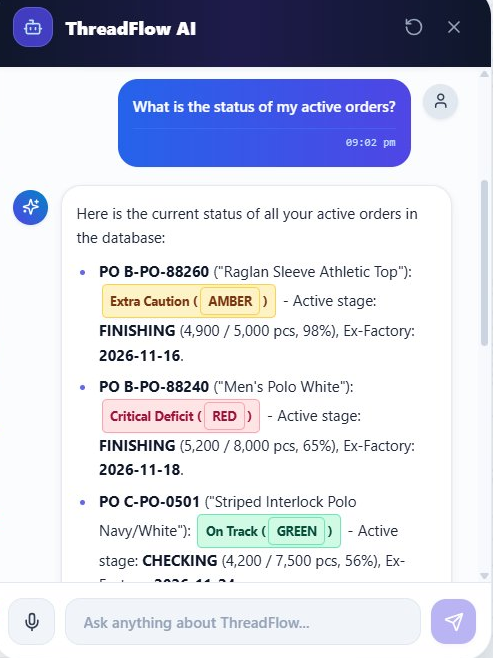
</p>

* **How to Navigate / Open It:**
  * **Role:** Available to all logged-in roles (`ADMIN`, `MERCHANDISER`, `SUPERVISOR`, `BUYER`).
  * **Path:** Click the floating **ThreadFlow AI button** (with the glowing star/robot emblem) anchored at the bottom-right corner of any screen.
* **Key Functionality:**
  * **Natural Language Database Telemetry:** Powered by Google Gemini and live production database grounding. Users can ask conversational questions such as:
    * *"What is the status of my active orders?"*
    * *"Which orders are currently in Finishing and what are their deficit rates?"*
    * *"Summarize B-PO-88260 progress and ex-factory risk."*
  * **Instant Structured Status Badges:** Formats replies with clear color-coded risk tags (`Extra Caution [AMBER]`, `Critical Deficit [RED]`, `On Track [GREEN]`), active TNA stage progress (`FINISHING: 4,900 / 5,000 pcs, 98%`), and precise ex-factory dates.
  * **Hands-Free Voice Querying:** Includes a native speech-to-text microphone button in the input pill, allowing shop floor managers and busy merchandisers to speak queries aloud.
  * **Thread Session Reset:** Includes a reload/reset button to clear context and start a clean inquiry session.

---

## Pre-Configured Demo Accounts & Role Directory

All pre-seeded accounts are active and authenticated with the standard password: `ThreadFlow@2026`

| Role | Name | Login Email | Password | Unit / Scope |
| :--- | :--- | :--- | :--- | :--- |
| **System Administrator** | System Administrator | `admin@threadflow.com` | `ThreadFlow@2026` | System Administration (All Features) |
| **Operations Admin** | Tiruppur Operations Admin | `admin.tiruppur@threadflow.com` | `ThreadFlow@2026` | Tiruppur Facility Operations |
| **Senior Merchandiser** | Ramesh Merchandiser | `merchandiser@threadflow.com` | `ThreadFlow@2026` | Factory-Wide Merchandising (All Units) |
| **Merchandiser** | Priya Sundaram | `priya.merchandiser@threadflow.com` | `ThreadFlow@2026` | Export Merchandising & Sourcing Requests |
| **Merchandiser** | Karthik Rajan | `karthik.merchandiser@threadflow.com` | `ThreadFlow@2026` | Export Merchandising & Sourcing Requests |
| **Supervisor (Unit 1)** | Muthu Floor Supervisor | `supervisor.muthu@threadflow.com` | `ThreadFlow@2026` | Unit 1 (Cotton Hub - 5 POs) |
| **Supervisor (Unit 1 Co-Lead)** | Kumaravel Shift In-Charge | `supervisor.kumar@threadflow.com` | `ThreadFlow@2026` | Unit 1 (Cotton Hub - 5 POs) |
| **Supervisor (Unit 2)** | Selvam Floor Supervisor | `supervisor.selvam@threadflow.com` | `ThreadFlow@2026` | Unit 2 (Stitching Hub - 4 POs) |
| **Supervisor (Unit 2 Co-Lead)** | Manickam Floor Supervisor | `supervisor.manickam@threadflow.com` | `ThreadFlow@2026` | Unit 2 (Stitching Hub - 4 POs) |
| **Supervisor (Unit 3)** | Murugan Floor Supervisor | `supervisor.murugan@threadflow.com` | `ThreadFlow@2026` | Unit 3 (Specialty & Export - 1 PO) |
| **Supervisor (PrintTex)** | Palanisamy PrintTex Supervisor | `supervisor.printtex@threadflow.com` | `ThreadFlow@2026` | Subcontract - PrintTex |
| **Supervisor (WashTex)** | Kandasamy WashTex Supervisor | `supervisor.washtex@threadflow.com` | `ThreadFlow@2026` | Subcontract - WashTex |
| **Buyer (UK - Company B)** | Sarah Jenkins | `buyer@company-b.co.uk` | `ThreadFlow@2026` | Company B Only (UK Sourcing Portal) |
| **Buyer (Germany - Company C)** | Klaus Mueller | `compliance@company-c.de` | `ThreadFlow@2026` | Company C Only (EU Compliance Portal) |
| **Buyer (Spain - Zara/Inditex)** | Laura Gomez | `laura.inditex@inditex.com` | `ThreadFlow@2026` | Zara / Inditex Only |
| **Buyer (UK - Marks & Spencer)** | David Ross | `sourcing@marksandspencer.co.uk` | `ThreadFlow@2026` | Marks & Spencer Only |
| **Buyer (UK - Next Retail)** | Emma Watson | `knitwear@next.co.uk` | `ThreadFlow@2026` | Next Retail Only |

---

## System Architecture

ThreadFlow is architected as a modular TypeScript stack with strict domain boundaries:

```
                    ┌────────────────────────────────────────────────────────┐
                    │               THREADFLOW UNIFIED FRONTEND               │
                    │         React 18 • TypeScript • Tailwind CSS • Vite     │
                    └──────────────────────────┬─────────────────────────────┘
                                               │
                                  Reverse Proxy /api/v1 (JWT)
                                               │
                    ┌──────────────────────────▼─────────────────────────────┐
                    │               THREADFLOW BACKEND ENGINE                │
                    │                Node.js • Express • TypeScript          │
                    ├────────────────────────────────────────────────────────┤
                    │  • Auth & RBAC Domain          • Risk & Capacity Math  │
                    │  • Orders & TNA Pipeline       • Offline Ingestion Queue│
                    │  • Gemini AI & Tamil NLP       • Buyer Portal Boundary │
                    │  • Cryptographic Audit Engine  • Weekly PDF Generator  │
                    └──────────────────────────┬─────────────────────────────┘
                                               │
                    ┌──────────────────────────▼─────────────────────────────┐
                    │            SUPABASE POSTGRESQL (ACID STORE)             │
                    │               Prisma ORM • Connection Pooler            │
                    └────────────────────────────────────────────────────────┘
```

---

## Quick Start (Local Setup)

### 1. Prerequisites
* **Node.js** v20+ (LTS)
* **npm** v10+
* **PostgreSQL** (Local instance or Supabase connection string)

### 2. Backend Setup
```bash
cd backend
npm install
npx prisma db push
npm run seed:calibrated
npm run dev
```
*The backend API server will start on `http://localhost:4000`.*

### 3. Frontend Setup
In a second terminal window:
```bash
cd frontend
npm install
npm run dev
```
*The frontend development server will start on `http://localhost:5173`.*

---

## Automated Test Verification

ThreadFlow includes 128 automated unit, integration, and mathematical invariant tests:

```bash
npm --prefix backend test
```

```
================================================================
🏁 RISK ENGINE TEST SUITE: 34 PASSED | 0 FAILED
🏁 RESILIENT TAMIL AI PIPELINE: 35 PASSED | 0 FAILED
🏁 ORDERS & TNA MILESTONE ENGINE: 32 PASSED | 0 FAILED
🏁 PRODUCTION INGESTION & INVARIANTS: 27 PASSED | 0 FAILED
================================================================
TOTAL: 128 PASSED | 0 FAILED (100% PASS RATE)
```

---

## Engineering Documentation

Detailed technical specifications and design runbooks are available in the repository:

* [**Reviewer Evaluation Guide (`docs/REVIEWER_GUIDE.md`)**](docs/REVIEWER_GUIDE.md) — Persona evaluation journeys, live credentials, and problem-solving mappings.
* [**Technical Design Document (`TECHNICAL_DESIGN_DOCUMENT.md`)**](TECHNICAL_DESIGN_DOCUMENT.md) — Comprehensive technical design covering relational schemas, invariant rules, and mathematical proofs.
* [**Deployment & Operations Runbook (`docs/DEPLOYMENT_RUNBOOK.md`)**](docs/DEPLOYMENT_RUNBOOK.md) — Render deployment guide, Supabase pooler tuning, and environment variable references.
* [**API & Data Model Specification (`docs/API_AND_DATA_SPECIFICATION.md`)**](docs/API_AND_DATA_SPECIFICATION.md) — Complete REST endpoint contract, entity dictionary, and design system tokens.
* [**Client Brief & Problem Statement (`docs/PROBLEM_STATEMENT.md`)**](docs/PROBLEM_STATEMENT.md) — Initial client brief, Tiruppur factory operational constraints, and baseline parameters.

---

<p align="center">
  <b>ThreadFlow Operating System</b> • Built for Modern Textile Manufacturing & Export Compliance
</p>
