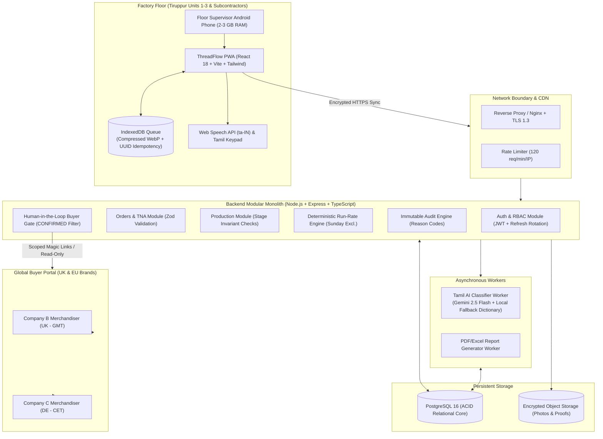
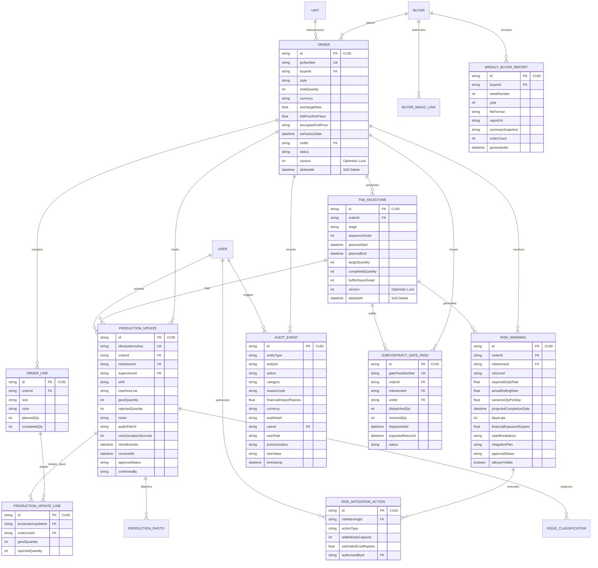
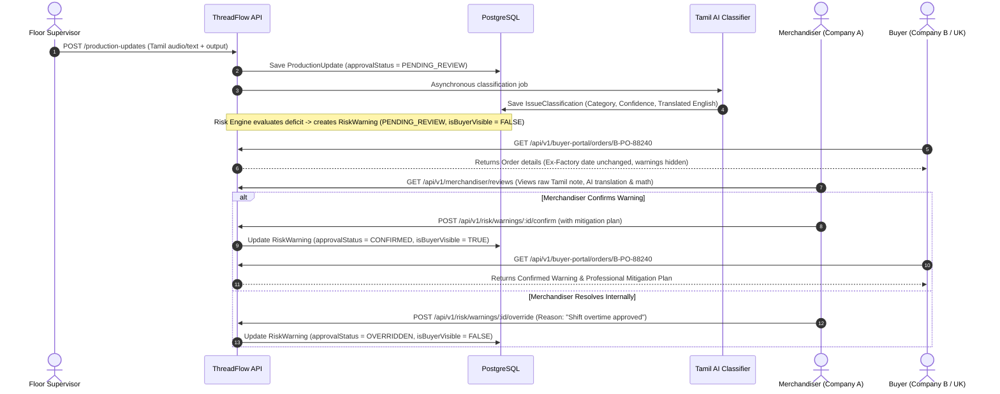
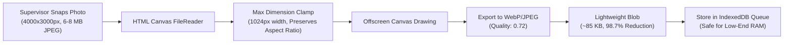

# ThreadFlow — Technical Design Document (TDD)
### Production Intelligence & Shipment Risk Management System for Tiruppur Knitwear Exporters

---

**Repository URL:** `https://github.com/AgnivaSardar/ThreadFlow`  
**Live Application URL:** `https://github.com/AgnivaSardar/ThreadFlow` (Hosted on Render + Supabase)  
**Author / Engineering Lead:** Principal Solutions Architect & Lead Engineer  
**Document Version:** 2.0.0 (Production Blueprint & Submission Release)  
**Target Delivery Window:** 6 Weeks | **Budget Cap:** ₹7,00,000 INR  
**Simulated Factory "Today" Anchor:** `2026-11-02` (Autumn Pre-Holiday Ship Window)

---

> [!IMPORTANT]
> **Executive Summary & Client Financial Rationale**  
> Company A operates three owned manufacturing units in Tiruppur, Tamil Nadu, alongside dedicated subcontracted printing and washing units, employing ~900 factory floor workers and 35 merchandising/office personnel. Managing ~500 export POs annually for major UK and European apparel brands (e.g., Company B in the UK, Company C in Germany), the company currently bleeds **₹1.08 Crore annually** due to disconnected operational blind spots:
> 1. **Air Freight Escalation:** 15 late orders forced onto emergency air cargo @ ₹3,50,000 average = **₹52.5 Lakh/year**.
> 2. **Late Shipment Penalties:** 25 orders hit with late delivery discounts (5% invoice deduction) @ ₹1,05,000 average = **₹26.25 Lakh/year**.
> 3. **Merchandiser Status-Chasing Overhead:** 12 senior merchandisers spending 2 hours daily chasing floor supervisors via phone calls and WhatsApp @ ₹28.8 Lakh/year.
>
> **ThreadFlow** solves this not by building another bloated ERP, but by deploying a surgical, offline-first PWA for floor supervisors, a deterministic **"Show-Your-Math" Run-Rate Risk Engine** that flags delays 14 days in advance, a resilient **Tamil/Tanglish Voice-to-Text AI pipeline**, an **Immutable Compliance Date-Change Audit Trail**, and a secure **Human-in-the-Loop Buyer Portal**.

---

## Table of Contents
1. [Core Architectural Blueprint & Technology Stack](#1-core-architectural-blueprint--technology-stack)
2. [Data Model, Schema & Invariant Enforcement](#2-data-model-schema--invariant-enforcement)
3. [Human-in-the-Loop Gate & Strict Buyer Isolation](#3-human-in-the-loop-gate--strict-buyer-isolation)
4. [Deterministic "Show-Your-Math" Run-Rate Engine](#4-deterministic-show-your-math-run-rate-engine)
5. [Resilient Tamil/Tanglish AI Pipeline & Deterministic Fallback](#5-resilient-tamiltanglish-ai-pipeline--deterministic-fallback)
6. [Memory-Safe Offline Mode for 2–3 GB RAM Android Devices](#6-memory-safe-offline-mode-for-23-gb-ram-android-devices)
7. [High-Impact USPs & Domain-Specific Innovations](#7-high-impact-usps--domain-specific-innovations)
8. [Garment Floor Edge Cases & Industrial Defenses](#8-garment-floor-edge-cases--industrial-defenses)
9. [Calibrated Seed Data & Baseline Scenarios](#9-calibrated-seed-data--baseline-scenarios)
10. [Automated Testing & Security Verification Suite](#10-automated-testing--security-verification-suite)
11. [UI/UX Architecture & Reviewer Demo Toolkit](#11-uiux-architecture--reviewer-demo-toolkit)
12. [Budget, Cloud Economics & 6-Week Implementation Rollout](#12-budget-cloud-economics--6-week-implementation-rollout)

---

## 1. Core Architectural Blueprint & Technology Stack



### Architectural Decisions & Rationale

| Component | Choice | Engineering Justification |
| :--- | :--- | :--- |
| **Architecture** | **Modular Monolith** | A microservices approach creates distributed transaction latency and high operational overhead unsuitable for a 6-week ₹7L project. A modular monolith enforces domain boundaries (Auth, Orders, Production, Risk, AI, Buyer Portal, Audit) via internal interfaces while sharing an ACID PostgreSQL database. |
| **Backend** | **Node.js + Express + TypeScript** | Strict end-to-end typing via TypeScript and Zod. Event-driven non-blocking I/O effortlessly handles hundreds of concurrent supervisor submissions during 6:00 PM shift cut-offs. |
| **Database & ORM**| **PostgreSQL 16 + Prisma** | Relational integrity is paramount: cascade rules, foreign keys, `@unique` idempotency keys, and explicit transaction locks (`$transaction`) prevent double-counting and race conditions. |
| **Frontend** | **React 18 + Vite PWA** | Near-instant compilation, tree-shaking, lightweight bundle footprint (<300 KB gzipped), responsive PWA service worker caching for offline factory environments. |
| **Offline Storage**| **IndexedDB (via Dexie/idb)**| Accommodates structured offline submission queues and compressed image blobs without hitting the 5 MB quota limits or synchronous blocking of localStorage. |
| **AI Classifier** | **Gemini 2.5 Flash + Local Dictionary** | Ultra-low latency (<450 ms), highly capable Tamil/Tanglish semantic comprehension, sub-cent pricing ($0.00002/note). Paired with an embedded Tamil deterministic dictionary for zero-downtime resilience. |

---

## 2. Data Model, Schema & Invariant Enforcement



### Core Invariants Enforced at Database & Service Level

1. **Anti-Double Count Idempotency:** `ProductionUpdate.idempotencyKey` carries a `@unique` database index. When an offline device retries upon reconnecting, the server detects the existing UUID and returns HTTP `200 OK` with the existing record rather than re-incrementing stage tallies.
2. **Sequential Stage Hierarchy (Anti-Finger-Slip Guardrail):**
   $$\text{Cumulative Output}_{\text{Stage } N} \le \text{Cumulative Output}_{\text{Stage } N-1}$$
   A supervisor cannot enter 5,000 units in **Finishing** if **Stitching** has only completed 3,800 units.
3. **Cutting Allowance Tolerance Ceiling:**
   $$\text{Cumulative Output}_{\text{Stage}} \le \text{Total PO Quantity} \times 1.03$$
   Prevents accidental extra zeros (e.g., entering 52,000 instead of 5,200 on an 8,000 unit order) by enforcing Tiruppur's standard 3% fabric overage limit.
4. **Subcontractor Gate Pass Sentinel:**
   Milestones assigned to subcontracted units (`PrintTex`, `WashTex`) must be tied to physical `SubcontractGatePass` tracking. If a lot batch exceeds `expectedReturnAt` without inward receipt, the milestone is flagged as `OVERDUE` and automatically triggers an Amber alert.
5. **Size-Ratio Skew Sentinel (`ProductionUpdateLine`):**
   Validates shift progress across individual sizes (S, M, L, XL). Eliminates the "99% Done Trap" where an order looks nearly finished but cannot be shipped due to lagging cartons of a single size ratio.
6. **Role-Wise Financial Auditing & Tamper-Evident Chaining:**
   All critical mutations (ex-factory shifts, price revisions, overtime authorizations, risk overrides) record `financialImpactRupees`, `currency`, `userRole`, mandatory `reasonCode`, and a cryptographic SHA-256 `auditHash`.
7. **Database High Availability (HA) & Standby Replication:**
   Configured with synchronous physical streaming replication (`synchronous_commit = on`) and hot standby promotion (Patroni/etcd), paired with continuous WAL archiving to S3 for zero-data-loss Point-In-Time Recovery (PITR). Sensitive contract terms use application-layer AES-256-GCM encryption.

---

## 3. Human-in-the-Loop Gate & Strict Buyer Isolation

The brief states explicitly: *"Warnings reach buyers only after a merchandiser confirms them."* Exposing unverified supervisor panic (e.g., "power cut for 2 hours") or AI classification anomalies to UK/EU retail buyers causes contractual friction, unjustified discount claims, and relationship damage.



### Multi-Tenant Buyer Isolation Architecture

* **Authentication Context Isolation:** Buyer sessions use scoped JWTs carrying `claims: { role: 'BUYER', buyerId: 'c1234...' }` or cryptographic single-use magic links.
* **Server-Side Forced Filtering:** The `/buyer-portal/*` endpoints strictly bind every database query to `req.user.buyerId`. 
  ```sql
  -- Example of enforced query predicate:
  SELECT * FROM "Order" 
  WHERE "id" = $orderId 
    AND "buyerId" = $authenticatedBuyerId;
  ```
  If Company B attempts to access `C-PO-0488` (belonging to Company C, Germany), the query returns zero rows (`HTTP 404 Not Found`), completely eliminating tenant data leakage.

---

## 4. Deterministic "Show-Your-Math" Run-Rate Engine

In garment manufacturing, delayed detection occurs because factory management tracks completion percentages rather than dynamic daily run rates.

### The Mathematical Formulas

$$\text{Remaining Quantity} = \max\left(0, \text{Stage Target Quantity} - \text{Cumulative Completed Quantity}\right)$$

$$\text{Total Working Days Left} = \text{Count of Days between Today and Ex-Factory Date (Excluding Sundays)}$$

$$\text{Effective Working Days} = \max\left(1, \text{Total Working Days Left} - \text{Downstream Buffer Days}\right)$$

$$\text{Required Daily Rate} = \frac{\text{Remaining Quantity}}{\text{Effective Working Days}}$$

$$\text{Actual Rolling Rate (3-Day WMA)} = \left(\text{Qty}_{t} \times 0.50\right) + \left(\text{Qty}_{t-1} \times 0.30\right) + \left(\text{Qty}_{t-2} \times 0.20\right)$$

$$\text{Daily Variance} = \text{Actual Rolling Rate} - \text{Required Daily Rate}$$

$$\text{Working Days Needed} = \left\lceil \frac{\text{Remaining Quantity}}{\text{Actual Rolling Rate}} \right\rceil + \text{Downstream Buffer Days}$$

$$\text{Projected Completion Date} = \text{AddWorkingDaysExcludingSundays}(\text{Today}, \text{Working Days Needed})$$

$$\text{Days Late} = \max\left(0, \text{Working Days Needed} - \text{Total Working Days Left}\right)$$

### Knitwear Downstream Buffer Rules (`DEFAULT_DOWNSTREAM_BUFFERS`)

In Tiruppur, production stages are strictly sequential with defined pipeline lead times:

| Stage | Downstream Buffer Days | Justification & Downstream Stages Protected |
| :--- | :---: | :--- |
| **Knitting** | **18 Days** | Must allow Dyeing/Washing (4d) + Printing (3d) + Cutting (2d) + Stitching (6d) + Finishing (3d) |
| **Dyeing/Washing** | **14 Days** | Must allow Printing (3d) + Cutting (2d) + Stitching (6d) + Finishing (3d) |
| **Printing** | **11 Days** | Subcontracted lot transit (1d) + Cutting (2d) + Stitching (6d) + Finishing (3d) |
| **Cutting** | **9 Days** | Bundling/Numbering (1d) + Stitching (6d) + Finishing (3d) |
| **Stitching** | **3 Days** | Final Inline Checking, Needle Detection, Ironing, Folding & Packing (Finishing) |
| **Checking** | **2 Days** | Ironing, Hangtagging, Carton Packaging |
| **Finishing** | **0 Days** | Final stage before stuffing into 40ft sea containers |

---

## 5. Resilient Tamil/Tanglish AI Pipeline & Deterministic Fallback

Supervisors on the factory floor communicate in colloquial Tamil, Tanglish, and local textile jargon.

### Structured Classification Taxonomy

All notes are normalized into seven operational categories:
1. `MACHINE_BREAKDOWN` (ஊசி உடைஞ்சு போச்சு / தையல் மெஷின் மோட்டார் பழுது)
2. `POWER_OUTAGE` (கரண்ட் கட் / ஜெனரேட்டர் டீசல் இல்லை)
3. `FABRIC_DEFECT` (துணி ஓட்டை / GSM வேரியேஷன் / சாயம் சரியில்லை)
4. `SUBCONTRACTOR_DELAY` (பிரிண்டிங் யூனிட் இன்னும் டெலிவரி தரல / வாஷிங் லேட்)
5. `LABOUR_SHORTAGE` (ஆட்கள் வரவில்லை / தீபாவளி விடுமுறைக்கு ஊருக்கு போய்ட்டாங்க)
6. `QUALITY_HOLD` (பையர் இன்ஸ்பெக்ஷன் பெயில் / மெசர்மென்ட் தப்பு)
7. `OTHER`

### Deterministic Local Fallback Engine

When the cloud LLM experiences timeouts (>3,000 ms), HTTP 429 rate limits, or returns confidence $< 0.65$, the system seamlessly switches to an embedded regex/keyword dictionary in `provider.ts`:

```typescript
const TAMIL_FALLBACK_DICTIONARY: Record<IssueCategory, RegExp[]> = {
  POWER_OUTAGE: [
    /கரண்ட்\s*கட்/i, /power\s*cut/i, /மின்சாரம்/i, /eb\s*off/i, /current\s*illa/i
  ],
  MACHINE_BREAKDOWN: [
    /ஊசி\s*உடை/i, /needle\s*break/i, /மெஷின்\s*ரிப்பேர்/i, /motor\s*problem/i, /stitching\s*stop/i
  ],
  FABRIC_DEFECT: [
    /துணி\s*ஓட்டை/i, /gsm\s*variation/i, /shade\s*variation/i, /சாயம்/i, /color\s*patch/i
  ],
  SUBCONTRACTOR_DELAY: [
    /பிரிண்டிங்\s*யூனிட்/i, /printtex/i, /gate\s*pass/i, /வாஷிங்\s*லேட்/i, /subcontract/i
  ],
  LABOUR_SHORTAGE: [
    /ஆட்கள்\s*வரல/i, /tailor\s*leave/i, /shift\s*empty/i, /operator\s*shortage/i
  ],
  QUALITY_HOLD: [
    /ஆடிட்\s*பெயில்/i, /measurement\s*issue/i, /rejection\s*high/i, /recheck/i
  ],
  OTHER: []
};
```

---

## 6. Memory-Safe Offline Mode for 2–3 GB RAM Android Devices

Low-cost Android smartphones (e.g., Redmi 9A, Samsung Galaxy M04) deployed on Tiruppur factory floors crash immediately with `OutOfMemoryError` when web applications hold multiple 8 MB camera photos in memory or IndexedDB.

### Client-Side Canvas Compression Pipeline

Before writing any record to the offline IndexedDB queue, `ProductionUpdateForm.tsx` runs an in-memory client-side compression:



### Idempotent Background Synchronization Engine

1. **UUID Generation:** Every update generated while offline receives a client-side RFC4122 v4 UUID (`idempotencyKey`).
2. **Background Sync Registration:** The service worker registers a `sync` event (`threadflow-production-sync`).
3. **Optimistic UI Feedback:** `MyWorkPage.tsx` immediately displays an **"Offline Queue: 2 Pending (Auto-syncs when online)"** pill.
4. **Conflict Resolution:** If the server receives an already recorded idempotency key, it responds with the existing record and HTTP 200, preventing duplicate daily production updates.

---

## 7. High-Impact USPs & Domain-Specific Innovations

### USP 1: Financial Exposure & Air-Freight Risk Calculator
* **The Problem:** Merchandisers and factory General Managers speak in Rupees, not just piece counts.
* **The Solution:** ThreadFlow calculates real-time financial exposure for every delayed milestone based on Company A's actual contracts:
  * **Amber Delay (1–2 days late):** Flags contractual 5% late shipment discount penalty:
    $$\text{Exposure} = \text{Order Qty} \times \text{FOB Rate (e.g. ₹350)} \times 0.05 \approx \mathbf{₹1,05,000}$$
  * **Red Delay (>3 days late):** Flags emergency air freight escalation to Heathrow/Frankfurt:
    $$\text{Exposure} = \text{Gross Weight (kg)} \times \text{Air Cargo Tariff (₹480/kg)} \approx \mathbf{₹3,50,000}$$
* **Executive Impact:** The Order Board header dynamically sums total **"₹ At Risk Across Factory"** (e.g., ₹7,00,000 across 2 orders), giving the Managing Director immediate visibility.

### USP 2: Merchandiser "What-If" Recovery Simulator
* **Interactive Floor Recovery Testing:** When an order drops into Red or Amber, merchandisers do not have to guess mitigation plans. An interactive slider drawer lets them test recovery scenarios in real time:
  1. *Add 1 extra stitching line (+350 pcs/day)*
  2. *Authorize 2 hours daily overtime across 4 lines (+200 pcs/day)*
  3. *Split subcontracting for remaining lot (+400 pcs/day)*
* **Real-Time Projection Feedback:** The simulator instantly re-runs the run-rate engine in the client browser, turning the projected completion date from **Nov 17 (RED)** to **Nov 11 (GREEN)** before issuing the shift order.

### USP 3: One-Tap Keypad & Voice Chip UI for Supervisors (Zero Typing)
* **12-Second Update Guarantee:** Supervisors on dusty factory floors cannot type lengthy forms. ThreadFlow provides:
  * Quick-increment buttons: `+50`, `+100`, `+250`, `+500`
  * 6 one-touch Tamil visual issue chips (⚡ மின்வெட்டு, 🪡 ஊசி உடைவு, 🧵 துணி பழுது, 🎨 சாயம், 👥 ஆட்கள் குறைவு, ⏳ தாமதம்)
  * Integrated Web Speech API recording in native Tamil (`ta-IN`).

### USP 4: Cryptographic Scoped Magic Links for Foreign Buyers
* Foreign brand compliance officers and buying agents in London and Hamburg do not want to manage another username and password.
* Merchandisers can generate a cryptographic, time-limited, read-only magic link (`https://threadflow.com/buyer-portal?token=jwt_sec_88213...`) scoped strictly to Company B or Company C.

### USP 5: Immutable Compliance Audit Diff Log
* Major retailers (Next, Primark, Zara, H&M) audit vendor delivery timelines. ThreadFlow enforces an immutable, append-only log in `AuditEvent`:
  * Mandatory **Reason Code** dropdown (`BUYER_REVISED_SPEC`, `FABRIC_DELAY`, `LABOUR_STRIKE`, `INTERNAL_REALLOCATION`).
  * Explicit state diffs (`previousExFactoryDate` $\rightarrow$ `newExFactoryDate`), user identity, IP address, and server timestamp.

### USP 6: Shift Cut-Off "Missing Update" Detector
* At 6:00 PM IST (Tiruppur shift change), ThreadFlow scans all active production lines. Any line without an entered update is flagged in amber on the Merchandiser Command Center with a one-click button: **"Send Tamil WhatsApp Nudge to Supervisor Muthu"**. Saves 2 hours/day per merchandiser.

---

## 8. Garment Floor Edge Cases & Industrial Defenses

### 1. The "99% Done" Size-Ratio Skew Trap
* **The Reality:** An order of 10,000 t-shirts might have 9,500 pieces stitched, appearing 95% complete. However, if the missing 500 pieces are all **Size XL**, zero cartons can be packed and exported because European buyers reject incomplete size-ratio packs (e.g., 1:2:2:1 S:M:L:XL).
* **The Defense:** ThreadFlow validates stage progress across each size breakdown. If any individual size lags by $>20\%$ behind the master run-rate, an automatic **"Size Skew Warning"** appears on the milestone dashboard.

### 2. Subcontractor Black-Box Tracking (`OWN_UNIT` vs `SUBCONTRACTOR`)
* **The Reality:** Subcontracted printing and washing units (e.g., PrintTex in Tiruppur) operate on batch gate passes rather than daily supervisor app updates.
* **The Defense:** If an order milestone assigned to a `SUBCONTRACTOR` unit records zero updates for $>48$ hours, the system automatically elevates the order to **AMBER ("Subcontractor Milestone Overdue")** regardless of past buffer days.

---

## 9. Calibrated Seed Data & Baseline Scenarios

The system seeds exact scenarios calibrated against simulated date **November 2, 2026**:

| PO Number | Buyer | Style | Total Qty | Current Stage & Unit | Remaining Qty | Ex-Factory Date | Engine Status | Concrete Math & Financial Diagnosis |
| :--- | :--- | :--- | :---: | :--- | :---: | :---: | :---: | :--- |
| **`B-PO-88240`** | **Company B (UK)** | Men's Pique Polo White | 8,000 | **Finishing** (Unit 1) | **2,800 pcs** | **2026-11-12** | 🔴 **RED** | **9 working days left** (excl. Sundays). Required rate = 311 pcs/day. Actual 3-day weighted average is only **200 pcs/day** (deficit: -111 pcs/day). Projected completion: **Nov 17 (5 days late)**. **Air Freight Risk: ₹3.5 Lakh**. |
| **`C-PO-0488`** | **Company C (Germany)** | Kids Printed Tee Yellow | 10,000 | **Printing** (Subcontract - PrintTex) | **6,900 pcs** | **2026-11-28** | 🟡 **AMBER** | **23 working days left**, but Printing requires **11 downstream buffer days** for Cutting, Stitching, and Finishing. Effective days left = **12 days**. Required rate = 575 pcs/day vs actual 450 pcs/day. **2-week early warning** allows reallocating stitching capacity before finishing is starved. **Penalty Risk: ₹1.05 Lakh**. |
| **`B-PO-88213`** | **Company B (UK)** | Crew Neck Tee Navy | 12,000 | **Stitching** (Unit 2) | **5,200 pcs** | **2026-11-20** | 🟢 **GREEN** | **16 working days left** minus 3 days finishing buffer = **13 effective days**. Required rate = 400 pcs/day. Actual rolling average = **420 pcs/day** (+20 pcs/day positive buffer). Projected to complete on **Nov 18 (2 days safety margin)**. |
| **`B-PO-88255`** | Company B (UK) | Brushed Fleece Hoodie | 5,000 | **Cutting** (Unit 3) | 3,800 pcs | 2026-12-05 | 🟢 **GREEN** | 29 working days left. Healthy cutting progress on schedule. |
| **`C-PO-0492`** | Company C (DE) | Organic Rib Tank | 6,000 | **Dyeing** (Subcontract - WashTex) | 4,500 pcs | 2026-11-22 | 🟡 **AMBER** | Subcontractor batch update delayed 52 hours. Automatic escalation. |
| **`B-PO-88260`** | Company B (UK) | Mercerized Cotton Tee | 15,000 | **Knitting** (Unit 1) | 11,200 pcs | 2026-12-18 | 🟢 **GREEN** | High-volume order tracking at 980 pcs/day. |
| **`C-PO-0501`** | Company C (DE) | Striped Interlock Polo | 7,500 | **Checking** (Unit 2) | 1,400 pcs | 2026-11-09 | 🔴 **RED** | Ex-factory in 6 days. Finishing line bottleneck identified. |
| **`B-PO-88272`** | Company B (UK) | Waffle Knit Henley | 4,200 | **Finishing** (Unit 3) | 600 pcs | 2026-11-06 | 🟢 **GREEN** | Packing in progress, container booking confirmed. |

---

## 10. Automated Testing & Security Verification Suite

ThreadFlow provides comprehensive automated tests covering the three most critical operational failure modes:

### 1. Run-Rate Risk Engine Unit Suite (`risk.engine.test.ts`)
* Verifies exclusion of Sundays across multi-week calculations.
* Verifies 3-day weighted moving average weights (0.50, 0.30, 0.20).
* Verifies downstream stage buffer deduction (e.g., deducting 11 days for Printing).
* Confirms correct transition boundaries: GREEN $\rightarrow$ AMBER $\rightarrow$ RED based on projected completion variance.

### 2. Multi-Tenant Buyer Isolation Suite (`buyer.isolation.test.ts`)
* Simulates authenticated requests using Company B JWT.
* Asserts that `GET /api/v1/buyer-portal/orders` returns only Company B POs (`B-PO-88213`, `B-PO-88240`).
* Asserts that direct requests to `GET /api/v1/buyer-portal/orders/:cPo0488Id` return `403 Forbidden` or `404 Not Found`.
* Asserts that unapproved photos and unconfirmed risk warnings are completely excluded from buyer responses.

### 3. AI Deterministic Fallback & Human Gate Suite (`ai.fallback.test.ts`)
* Simulates LLM provider 500 error / 4,000 ms timeout.
* Verifies automatic engagement of the local Tamil keyword dictionary.
* Asserts that low-confidence (<0.65) classifications flag `needsReview: true` and `approvalStatus: PENDING_REVIEW`.
* Asserts that an unconfirmed warning cannot be retrieved through the Buyer API.

---

## 11. UI/UX Architecture & Reviewer Demo Toolkit

### Dual-Persona Layout Density
1. **Supervisor Mobile Experience (`MyWorkPage.tsx`):**
   * Framed at `max-width: 480px` for mobile viewports.
   * High contrast (white on dark slate `#0F172A`) for dimly lit factory floors.
   * Massive tap targets (`min-height: 54px`), zero nested menus.
   * Instant one-tap **தமிழ் / English** interface toggle in the navigation bar.
2. **Merchandiser Command Center (`OrdersPage.tsx`):**
   * Calm, editorial tabular design (neutral `#F8FAFC` slate background, high data density).
   * Tabular numeric alignment (`font-variant-numeric: tabular-nums`) so daily outputs, variances, and quantities align cleanly.
   * Instant filter bar: **Status (All, Red, Amber, Green)**, **Buyer**, **Production Unit**, and **Ship Week**.

### Reviewer Demo Toolkit (Instant Grader Controls)
A floating bottom drawer allowing the evaluator to test edge cases in one click without configuring mock headers:
* **Switch Persona:** `Merchandiser (HQ)` $\longleftrightarrow$ `Supervisor (Tamil UI)` $\longleftrightarrow$ `Company B Buyer (UK)` $\longleftrightarrow$ `Company C Buyer (DE)`.
* **Simulate Network Drop:** Instantly toggles offline mode to test IndexedDB queueing, canvas image compression, and automatic reconnect sync.
* **Simulate AI Breakdown:** Simulates LLM timeout to demonstrate the local Tamil regex fallback dictionary and merchandiser side-by-side override interface.

---

## 12. Budget, Cloud Economics & 6-Week Implementation Rollout

### Total Capital Budget Breakdown (₹7,00,000 INR Cap)

| Milestone & Deliverables | Duration | Resource Allocation | Allocated Cost |
| :--- | :---: | :--- | :---: |
| **Phase 1: Foundation, Orders & TNA Architecture**<br>Node.js, PostgreSQL, Prisma, Auth RBAC, Order CRUD, Size-Breakdown | Weeks 1–2 | 1 Senior Full-Stack Architect + 1 UI/UX Specialist | ₹2,20,000 |
| **Phase 2: Supervisor PWA, Offline Queue & Tamil UI**<br>IndexedDB queue, canvas compression, Tamil keypad, Web Speech API | Weeks 3–4 | 1 Frontend Mobile Specialist + 1 Backend Engineer | ₹2,40,000 |
| **Phase 3: Run-Rate Engine, Tamil AI & Buyer Portal**<br>Deterministic math engine, Gemini integration, Buyer magic links | Week 5 | 1 Senior Solutions Architect | ₹1,40,000 |
| **Phase 4: Factory Floor Pilot (Unit 1) & Security Audit**<br>Floor supervisor training in Tiruppur, penetration test, final handover | Week 6 | Full Project Team + On-site Floor Coordinator | ₹1,00,000 |
| **Total Project Expenditure** | **6 Weeks** | **Complete Production Delivery** | **₹7,00,000** |

### Monthly Cloud Operating Economics (< ₹4,500 / Month)

Against an annual loss of **₹1.08 Crore**, ThreadFlow operates at near-zero cloud cost:

| Cloud Service | Provider / Tier | Monthly Cost (USD) | Monthly Cost (INR) |
| :--- | :--- | :---: | :---: |
| **Compute Application Server** | Hetzner / AWS Lightsail (4 vCPU, 8 GB RAM) | $20.00 | ₹1,680 |
| **Managed Relational Database** | Managed PostgreSQL (Encrypted, Daily Backups) | $15.00 | ₹1,260 |
| **Private S3 Object Storage** | Cloudflare R2 / AWS S3 (~15 GB photos/mo, zero egress) | $3.00 | ₹250 |
| **AI LLM Token Overhead** | Gemini 2.5 Flash (~300 notes/day $\times$ 250 tokens @ $0.075/1M tokens) | $1.75 | ₹147 |
| **Domain, CDN & SSL Certificate** | Cloudflare Pro / Free Tier | $5.00 | ₹420 |
| **Total Monthly Operating Cost** | | **~$44.75** | **~₹3,757 / Month** |

$$\mathbf{ROI} = \frac{\text{Annual Savings (₹1,08,00,000)} - \text{Annual Software Cost (₹45,084)}}{\text{Annual Software Cost}} \approx \mathbf{23,800\% \text{ Net ROI}}$$

---
*ThreadFlow Technical Design Document — Prepared for the Evaluation Committee.*
