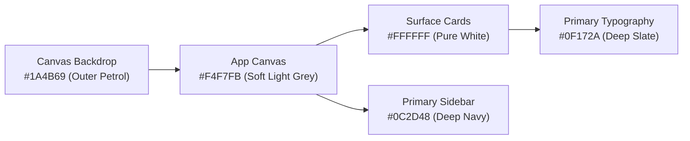

# ThreadFlow — UI Design System & Theme Specification

**Theme Mode:** **Light Theme Only** with High-Contrast Navy Navigation & Petrol Backdrop  
**Design Archetype:** Modern Enterprise Executive ERP (Inspired by Clean SaaS Analytics & Neomorphic Soft Card Architecture)

---

## 1. Color Palette & Token Hierarchy

### Core Palette Tokens

| Token Name | Hex Code | Tailwind Equivalent | Usage Context |
| :--- | :---: | :--- | :--- |
| **`app-backdrop`** | `#1A4B69` | `bg-[#1A4B69]` | Outer viewport framing and desktop backdrop canvas. |
| **`app-canvas`** | `#F4F7FB` | `bg-[#F4F7FB]` | Main application background (dashboard work area). |
| **`card-surface`** | `#FFFFFF` | `bg-white` | All metric cards, data tables, chart containers, and modal surfaces. |
| **`card-border`** | `#EDF2F7` | `border-slate-100` | Subtle, non-intrusive card outlines. |
| **`sidebar-navy`** | `#0C2D48` | `bg-[#0C2D48]` | Master left navigation bar for desktop and tablet screens. |
| **`sidebar-active`** | `#164368` | `bg-[#164368]` | Active nav link background highlight. |
| **`accent-amber`** | `#F59E0B` | `text-amber-500` | Active nav indicator pip, warnings, and accent highlight bar. |
| **`text-primary`** | `#0F172A` | `text-slate-900` | Section titles, big numerical metric totals, table headers. |
| **`text-secondary`**| `#475569` | `text-slate-600` | Field labels, table body content, body copy. |
| **`text-muted`** | `#8CA7BE` | `text-slate-400` | Sidebar inactive icons, timestamp subtitles, helper hints. |

---

## 2. Metric & Status Badges (Soft Pastel Pills)

All status pills use translucent pastel backgrounds paired with dark, accessible text:

| Industrial Status | Pill Background | Text Color | Border Color | Real-World Garment Context |
| :--- | :---: | :---: | :---: | :--- |
| **`GREEN` / On Schedule** | `#ECFDF5` | `#047857` | `#A7F3D0` | Run rate exceeds daily requirement; positive safety buffer. |
| **`AMBER` / Early Warning** | `#FFFBEB` | `#B45309` | `#FDE68A` | Subcontractor lag >48h or 1–2 days projected deficit. |
| **`RED` / Critical Late** | `#FEF2F2` | `#B91C1C` | `#FECACA` | >3 days projected delay; air freight financial escalation. |
| **`IN_PROGRESS`** | `#F0F9FF` | `#0369A1` | `#BAE6FD` | Milestone active on floor (Knitting, Stitching, Finishing). |
| **`COMPLETED`** | `#F8FAFC` | `#334155` | `#E2E8F0` | Stage finished and verified against PO target count. |

---

## 3. Visual Components Architecture

### A. Metric Stat Cards (Top Row)
* **Geometry:** `rounded-2xl`, `bg-white`, `border border-slate-100`, `shadow-[0_2px_10px_rgba(0,0,0,0.03)]`.
* **Internal Layout:**
  * Top: Subtitle in uppercase bold tracking (`text-[11px] font-semibold tracking-wider text-slate-400`).
  * Center: Prominent numerical statistic (`text-2xl font-bold text-slate-900`).
  * Right: Micro-SVG sparkline chart (cyan upward curve, amber flat curve, or red deficit curve).
  * Bottom: Comparison badge pill (e.g. `+12% vs last week`, `4 days safety buffer`).

### B. Analytical Charts (Mid Row)
* **Run-Rate Spline Chart:**
  * Smooth cubic Bezier line with warm orange-coral gradient fill (`rgba(249, 115, 22, 0.15)` to `rgba(249, 115, 22, 0.0)`).
  * Interactive tooltips with white card backdrop, rounded corners, and crisp drop shadows.
* **Stage Distribution Donut Chart:**
  * Multi-colored concentric ring: Cyan (`#06B6D4`), Amber (`#F59E0B`), Coral (`#F97316`), Blue (`#3B82F6`), Teal (`#10B981`).
  * Center stat cutout showing total pieces completed (`7,800 pcs` or overall PO %).
  * Right-side legend with colored indicator dots, category name, piece count, and percentage.

### C. Master Data Table (Bottom Section)
* **Header:** Pure white, subtle grey borders (`#F1F5F9`), uppercase font (`text-xs font-semibold text-slate-500`).
* **Rows:** Hover state with gentle blue tint (`hover:bg-slate-50/80`).
* **Item Cells:** Style image thumbnail (or stage avatar), PO number in mono font, buyer code, status pill, quantity count, and progress bar.

### D. Navigation Sidebar (Left Column)
* **Background:** Deep Midnight Navy (`#0C2D48`).
* **Active Indicator:** Left border or accent pip in amber/yellow (`#F59E0B`).
* **Bottom Promotion / Shift Cut-off Box:**
  * Rounded container with teal-to-blue gradient accent.
  * Prominent action button ("Send Shift Nudge", "Optimize Line").

---

## 4. Typography & Spacing Standards
* **Font Family:** `Inter`, `-apple-system`, `BlinkMacSystemFont`, `Segoe UI`, `Roboto`, `sans-serif`.
* **Headings:** Bold `text-xl` or `text-2xl` in `#0F172A` with -0.02em letter spacing.
* **Numbers & Metric Data:** `tabular-nums` for precise vertical alignment across currency, PO piece counts, and percentages.
* **Card Border Radius:** Standard `rounded-2xl` (`16px`).
* **Button Radius:** `rounded-xl` (`12px`).
